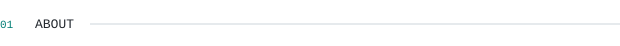
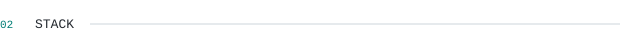
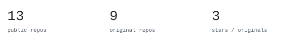
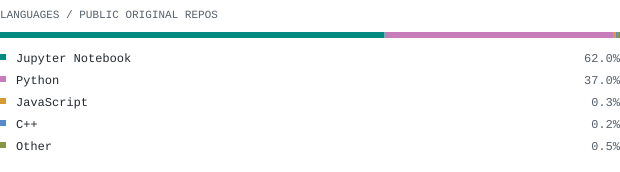
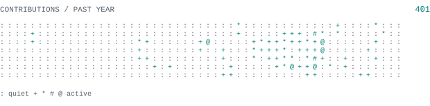

[repo](https://github.com/yx-lim?tab=repositories) &nbsp;&middot;&nbsp; 
[instagram](https://www.instagram.com/yitxueng/) &nbsp;&middot;&nbsp; 
[linkedin](https://www.linkedin.com/in/limyitxueng/) &nbsp;&middot;&nbsp; 
[email](yitxuenglim@gmail.com)

<!-- Add your portfolio, LinkedIn, or a public contact link here. -->

> EECS student at University of Edinburgh  
> ready to take on the world!

I build in the software-hardware space and   right now that's robotics research and FPGA.  

<!-- Replace this line with the languages and tools you use. -->
<samp>python &nbsp; C++ &nbsp; java &nbsp; javascript &nbsp; react &nbsp; fastapi &nbsp; postgres &nbsp; firebase &nbsp; docker &nbsp; git &nbsp; linux</samp>

<!-- These descriptions come from your public repositories. Edit, reorder, or replace them. -->
**[ghostgui](https://github.com/yx-lim/ghostgui)** &nbsp;&middot;&nbsp; <samp>python</samp> 
Motion generation software.

**[rescue-robot](https://github.com/yx-lim/rescue-robot)** &nbsp;&middot;&nbsp; <samp>python</samp> 
Fire-aware robot path planning with D* Lite, repeated A*, and Temporal A*.

**[mjlab-trained](https://github.com/yx-lim/mjlab-trained)** &nbsp;&middot;&nbsp; <samp>jupyter notebook</samp> 
Motion samples based on mjlab.

Repository and language statistics cover public repositories. Language totals exclude forks and this profile repository. Contribution activity follows GitHub's visible calendar. Graphics refresh daily.

Original SVG graphics, generated in this repository. Inspired by [Andrii Drok's profile](https://github.com/andriidrok1). Built with Markdown, Python, and GitHub Actions.
